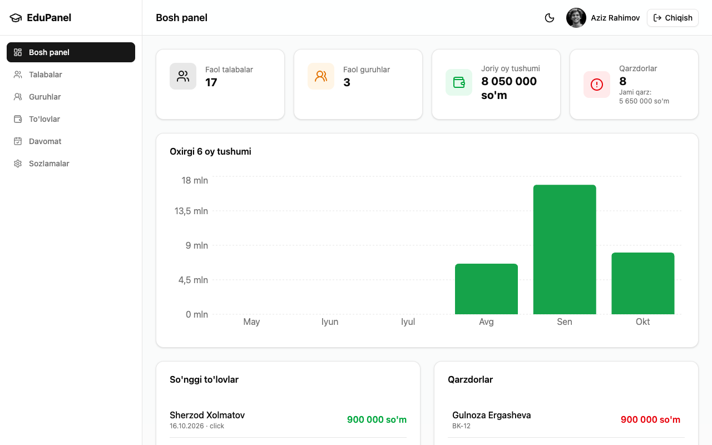
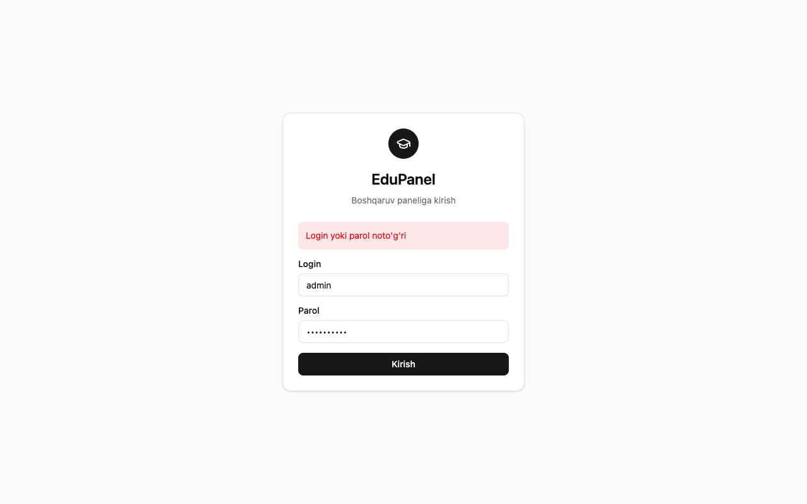
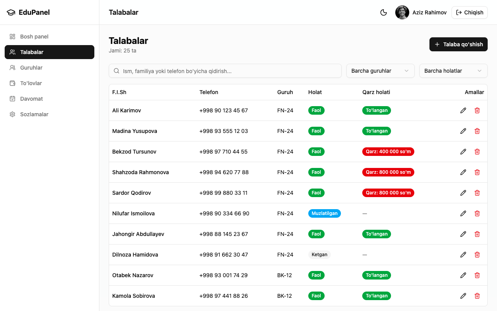
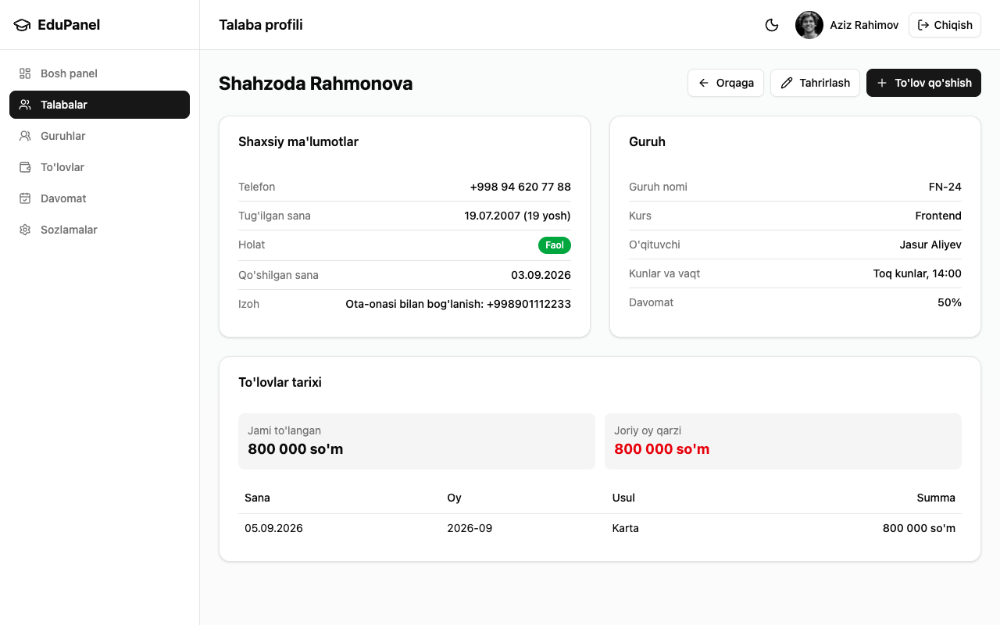
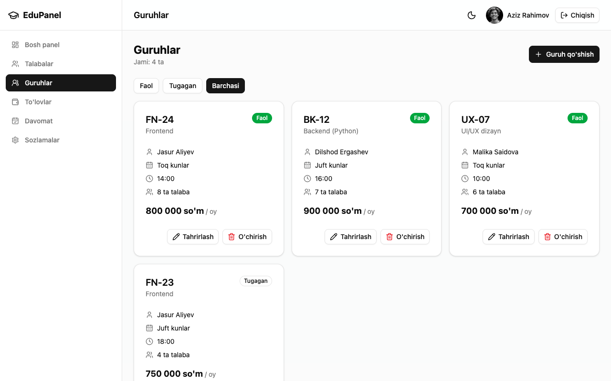
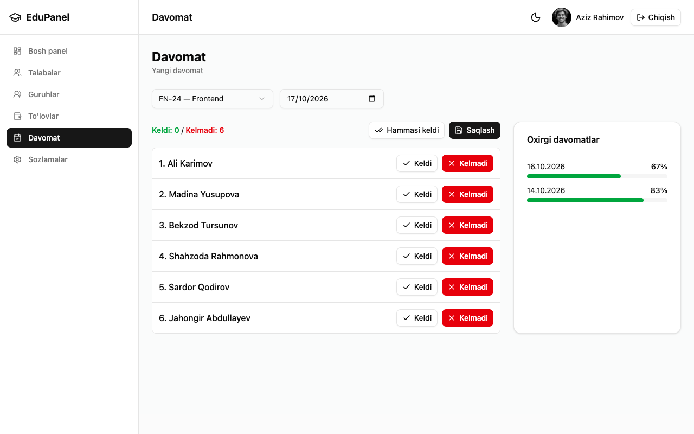
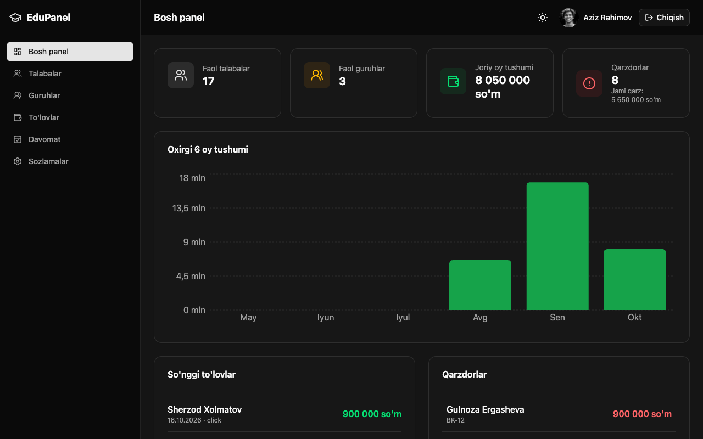
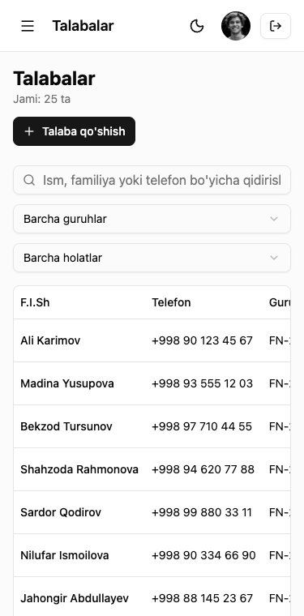

# EduPanel — o'quv markazi boshqaruv paneli

O'quv markazi administratori uchun React'da yozilgan admin panel: talabalarni ro'yxatga olish, guruhlarga biriktirish, oylik to'lovlarni qabul qilish, qarzdorlarni kuzatish va davomatni belgilash.



## Imkoniyatlar

- **Kirish** — React Hook Form + Zod validatsiyasi, himoyalangan yo'llar, kirgan admin `/login` dan qaytariladi
- **Bosh panel** — faol talabalar, faol guruhlar, joriy oy tushumi, qarzdorlar soni va jami qarz; so'nggi 5 to'lov; eng katta 5 qarzdor; oxirgi 6 oy tushumi grafigi
- **Talabalar** — jadval, debounce (500 ms) qidiruv, guruh va holat filtrlari, sahifalash (`X-Total-Count`), qo'shish / tahrirlash / o'chirish
- **Talaba profili** — shaxsiy va guruh ma'lumotlari, to'lovlar tarixi, joriy oy qarzi, davomat foizi, shu yerning o'zidan to'lov qo'shish
- **Guruhlar** — kartalar, Faol / Tugagan / Barchasi filtri, CRUD; talabasi bor guruhni o'chirib bo'lmaydi
- **Guruh sahifasi** — talabalar soni, kutilayotgan oylik tushum, to'lagan / to'lamaganlar
- **To'lovlar** — oy va usul bo'yicha filtr, jami summa, avtomatik summa (talaba guruhi narxi), to'liq to'langan oy uchun ogohlantirish, CSV eksport
- **Davomat** — guruh va sana tanlash, "Hammasi keldi", jonli hisob, mavjud yozuvni tahrirlash (PATCH) yoki yangisini yaratish (POST), oxirgi 10 davomat
- **Sozlamalar** — admin profili, parolni o'zgartirish, dark mode
- Responsive (375 / 768 / 1280 px), mobil sidebar, dark mode `localStorage` da saqlanadi

**Qarz qoidasi:** faol talabaning joriy oydagi qarzi = guruhining `monthlyPrice` − shu talaba joriy oy uchun to'lagan summa. Hisob bitta funksiyada — [`src/utils/debt.js`](src/utils/debt.js).

## Texnologiyalar

| Texnologiya | Vazifasi |
|---|---|
| Vite + React 19 | Loyiha asosi |
| React Router v6 | Nested, dinamik, himoyalangan yo'llar, 404 |
| Tailwind CSS v4 | Dizayn, responsive, dark mode |
| shadcn/ui | Button, Card, Input, Label, Dialog, Select, Table, Badge, Skeleton, Sonner (Toast) |
| React Hook Form + Zod | Barcha formalar va validatsiya |
| Axios | Bitta `axios.create()` instansiyasi (`src/api/axios.js`) |
| PropTypes | Props turlarini tekshirish |
| Recharts | Tushum grafigi |
| json-server 0.17.4 | Soxta REST backend |

## Ishga tushirish

```bash
git clone https://github.com/odiltiu/edupanel-odil-xusanov.git
cd edupanel-odil-xusanov
npm install
```

Ikkita alohida terminalda:

```bash
npm run server   # json-server — http://localhost:3001
npm run dev      # ilova — http://localhost:5173
```

## Kirish ma'lumotlari

| Login | Parol |
|---|---|
| `admin` | `admin123` |

## Papka tuzilishi

```
src/
  api/          # serverga so'rovlar (axios instansiyasi + har bir resurs uchun funksiyalar)
  components/
    ui/         # shadcn komponentlari
    layout/     # Sidebar, Topbar
    common/     # StatCard, ConfirmDialog, Pagination, Empty/Error/LoadingState, PageHeader, FormField
    students/   # StudentForm, StudentsTable, StatusBadge, ...
    groups/     # GroupForm, GroupCard, ...
    payments/   # PaymentForm, PaymentsTable, ...
    attendance/ # davomat komponentlari
  layouts/      # DashboardLayout (<Outlet />)
  routes/       # ProtectedRoute, PublicRoute
  pages/        # 10 ta sahifa
  schemas/      # Zod schemalar
  utils/        # format, date, debt, attendance, csv, storage, theme
db.json         # 1 admin, 4 guruh, 25 talaba, 40 to'lov, 6 davomat
```

## Skrinshotlar

| Kirish | Talabalar |
|---|---|
|  |  |

| Talaba profili | Guruhlar |
|---|---|
|  |  |

| Davomat | Dark mode |
|---|---|
|  |  |

<p align="center"></p>

## Bonuslar

- [x] Bosh panelda oxirgi 6 oy tushumi grafigi (Recharts)
- [x] To'lovlar jadvalini CSV faylga eksport qilish
